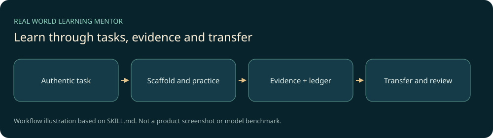

# 真实应用驱动学习导师

把“我想学习”转成一个可落地的真实任务，边做边补必要理论，用渐进提示、排错、证据和迁移练习形成独立能力。学习记录由本地事件账本保存，跨会话继续时先恢复事实和下一步，而不是重新采访或只展示课程目录。



## 主要功能

- 工程编程、科学实验、数据数学、职业商业、语言、人文、设计和工具八类适配。
- 体验、跟做、解释、修改、排错、迁移和综合作品的任务阶梯。
- 十种学习方法按目标组合，记录准备度、证据等级、掌握度与待复习项。
- 本地状态的revision、幂等键、事件哈希、冲突检测、派生状态恢复。

普通事实问答、明确纯代做且无学习意图的请求不强制进入导师流程。学习判断依赖真实证据，编译成功不等于实板验证或独立掌握。

## 快速开始

准备支持项目Skill的AI宿主和Python3.12+。核心CLI只用标准库，离线状态管理不需要API密钥。下载仓库后：

```powershell
python tools/prepare_workspace.py
python .agents/skills/real-world-learning-mentor/scripts/state_tool.py --state-dir Learner_State status
python .agents/skills/real-world-learning-mentor/scripts/state_tool.py --state-dir Learner_State validate
```

随后在项目目录让宿主加载`.agents/skills/real-world-learning-mentor/SKILL.md`，例如：

```text
使用 $real-world-learning-mentor 教我Python。我希望先做一个整理自己示例文件的小工具，再通过解释和改造证明理解。
```

也可仅将`.agents/skills/real-world-learning-mentor`复制到宿主的个人技能目录；已有目录先备份审阅差异。状态始终保存在自己的工作区，禁止把`Learner_State/`提交到公共仓库。

## 技术、结构与测试

```text
.agents/skills/real-world-learning-mentor/  完整技能、两个CLI、参考和模板
tests/ evals/                             既有确定性测试与行为评测工具/定义
examples/codex/                           原项目只读角色配置示例，不自动启用
docs/research/                            原始方法/许可/来源调研
tools/prepare_workspace.py                新建空状态与可选测试配置
```

执行已有确定性检查：

```powershell
python -m pip install -r requirements-dev.txt
python tools/prepare_workspace.py --test-config
python -m pytest -q
```

第二行只应在还没有`.codex`目录的新副本使用。它复制历史角色配置供结构测试，不启动子Agent、不注册MCP；其中模型名是历史定义，当前宿主可用性未验证。已有配置会被拒绝覆盖。测试生成的空状态与配置均被Git忽略。

`evals/run_pairwise_behavior.py`是需要额外模型/宿主配置的行为评测工具，此次没有运行，不应把测试数据或规则数量称作模型实际通过数。测试结果与局限见[VALIDATION.md](VALIDATION.md)。

## 来源、许可与后续

本机独立定制项目，采用AI辅助开发；项目源与已安装技能36文件一致。原研究登记明确只参考抽象机制，不复制第三方课程、题目、实现、图片或用户状态。保留[借鉴日志](docs/research/borrowing-log.md)与[许可登记](docs/research/license-ledger.json)，自有代码和文档采用[MIT](LICENSE)。

这份公开源码没有真实学习档案、原始聊天、历史评测重放、机器配置或相邻STM32硬件工程。后续优先通过授权的实际课堂验证任务负担、迁移与连续性，更新见[CHANGELOG.md](CHANGELOG.md)。
